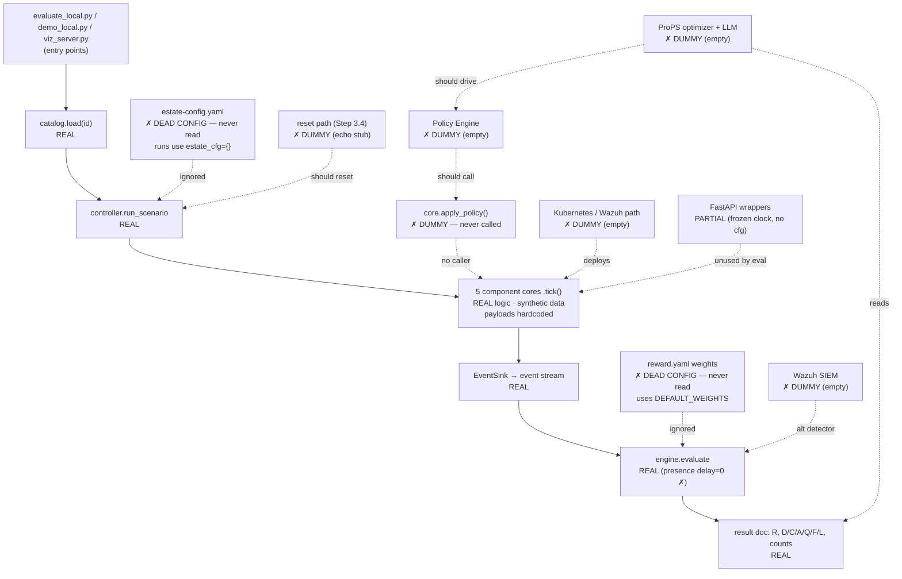

# ProPS-Twin — Implementation Plan & Codebase Audit

**Written for:** an ML engineer who is *not* a cybersecurity domain expert. Security
terms are defined on first use. Date: 2026-11-13.
**Method:** every claim below cites `file:line` from the code as it exists now. No
code was changed to produce this document.

---

## 0. What this project is (one paragraph)

**ProPS-Twin** is a *digital twin* (a software simulation that stands in for a real
system) of the **IT/OT security department** of a nuclear power plant. **IT** =
ordinary office/computer networks; **OT** = "operational technology", the
industrial control systems that run physical plant equipment. Five simulated
components emit **security telemetry** (a stream of log events — heartbeats,
alerts, status records). Scripted **cyber scenarios** perturb that stream; a
**log-only evaluator** scores how well a given **defensive policy** (a bundle of
tunable security settings) detects and contains each incident, producing a single
scalar **reward** `R`. The eventual research goal (not yet built) is to put an
**LLM** in a loop that proposes better policies — the method is **ProPS** =
*Prompted Policy Search* (Zhou et al., NeurIPS 2025), see
[docs/props_notes.md](props_notes.md).

The repo is deliberately **simulation-first**: the estate, the scenarios and the
scoring run today in a bare terminal with only the Python standard library. The
cluster, the real monitoring tool (Wazuh), and the LLM optimizer are later phases
and are currently empty scaffolding.

### How to read the status labels

Because the *entire estate is synthetic by design*, "real data" cannot mean
"production network traffic". So in this audit:

| Label | Meaning here |
|---|---|
| **REAL** | Working logic that behaves as the architecture intends. For a *simulator* component this includes synthetic-but-principled telemetry (seeded random noise + deterministic rules). |
| **PARTIAL** | Real structure, but with placeholder data values, dead wiring (config that is never read, methods never called), or a missing sub-piece. |
| **DUMMY** | Stub, empty file, `.gitkeep`, or an echo-only Makefile target. Not built. |
| **UNKNOWN** | Cannot be determined without running something; the exact check is named. |

A separate flag, **synthetic-by-design**, marks data that is intentionally
generated (the whole point of a twin) rather than an accidental stub.

---

## 1. Summary table

| # | Component | File | Status | Data source | Effort to make "real" |
|---|---|---|---|---|---|
| 1 | Seeded RNG helpers | `research/common/sim.py` | **REAL** | `random.Random(seed)` PRNG | — (done) |
| 2 | Event model + sink | `research/common/props_log.py` | **REAL** | Constructed dicts; SHA-256 ids | — (done) |
| 3 | IDMZ gateway core | `services/idmz_gateway/core.py` | **REAL** logic / **PARTIAL** realism | Gaussian noise + **hardcoded** attack payloads | M (richer payloads) |
| 4 | Boundary firewall core | `services/boundary_firewall/core.py` | **REAL** logic / **PARTIAL** realism | Gaussian + hardcoded consts | S–M |
| 5 | Eng-station core | `services/eng_station/core.py` | **REAL** logic / **PARTIAL** realism | Hardcoded signatures (`EICAR-TEST`, `CVE-0000-0000`) | M |
| 6 | PLC-edge core | `services/plc_edge/core.py` | **REAL** logic / **PARTIAL** realism | Hardcoded checksums | S |
| 7 | Telemetry forwarder core | `services/telemetry_forwarder/core.py` | **REAL** | Gaussian + buffer-drain state machine | — (done) |
| 8 | Scenario controller | `research/scenario_controller/controller.py` | **REAL** | In-process sim loop | — (done) |
| 9 | Scenario validator | `research/scenario_controller/models.py` | **PARTIAL** | Plain validator (Pydantic promised, not done) | S |
| 10 | Scenario catalog | `research/scenario_controller/catalog.py` | **REAL** | Built-in dicts + YAML | — (done) |
| 11 | Evaluation engine | `research/evaluation/engine.py` | **REAL** / one **PARTIAL** metric | Log-only detector over the event stream | S (delay fix) |
| 12 | Metric functions | `research/evaluation/metrics.py` | **REAL** | Pure functions of counts | — (done) |
| 13 | FastAPI wrappers ×5 | `services/*/main.py` | **PARTIAL** | No config, frozen clock, shared sink | M |
| 14 | `estate-config.yaml` | `configs/estate/` | **PARTIAL (dead config)** | Never opened by any `.py` | S (wire it in) |
| 15 | `reward.yaml` | `configs/evaluation/` | **PARTIAL (dead config)** | Never opened; weights hardcoded | S (wire it in) |
| 16 | Policy application path | `apply_policy()` in every core | **DUMMY (never called)** | n/a | M |
| 17 | Reset path (Step 3.4) | `controller.py` / `Makefile:24` | **DUMMY** | echo stub | S |
| 18 | Policy Engine | `research/policy_engine/` | **DUMMY** | 2-line README | M |
| 19 | ProPS optimizer + LLM | `research/props_optimizer/` | **DUMMY** | 2-line README | L (research core) |
| 20 | Wazuh monitoring | `wazuh/` | **DUMMY** | `.gitkeep` only | L |
| 21 | Kubernetes (kind+Calico) | `k8s/`, `cluster/` | **DUMMY** | `.gitkeep` only | L |
| 22 | Docker images | `services/*/Dockerfile`, `docker-compose.yml` | **PARTIAL / UNKNOWN** | Dockerfiles exist, never built here | M |

Effort key: **S** ≈ ≤1 day, **M** ≈ 2–4 days, **L** ≈ 1–3 weeks.

---

## 2. Component-by-component audit

### 2.1 `research/common/sim.py` — seeded randomness — **REAL**

Two helpers, the only source of stochasticity in the whole simulation.

- `rng_for(seed:int, offset:int=0) -> random.Random` — `sim.py:7`. Returns an
  independent PRNG stream. **`offset` is what keeps component streams from
  colliding**: idmz=0, firewall=1, forwarder=2, plc=3, eng=4, and the *probe*
  streams use 20/22 so availability probing never disturbs the telemetry stream
  (`idmz_gateway/core.py:33-34`, `telemetry_forwarder/core.py:26-27`). Changing
  `seed` changes the whole run; changing `offset` re-aligns a component to a
  different noise stream.
- `gauss_nonneg(rng, mean, sigma) -> float` — `sim.py:12-14`. A Gaussian clamped
  at 0 (`max(0.0, rng.gauss(...))`), used for drop-rates, latencies, memory %.

**Data source:** deterministic PRNG. Reproducible for a fixed seed by design.

### 2.2 `research/common/props_log.py` — event model + `EventSink` — **REAL**

The one JSON object emitted per log line, and the object that stamps it.

- `build_event(...)` — `props_log.py:31-66`. Asserts `severity ∈ {low, medium,
  high, critical}` (`SEVERITIES`, line 16), `state ∈ {normal, anomalous, fault,
  violation}` (`STATES`, line 17), `zone ∈ {enterprise, idmz, supervisory,
  control, field}` (`ZONES`, line 18). **Ground truth is deliberately not a
  field** — the honesty invariant (see §2.8).
- `deterministic_event_id(experiment_id, component, seq)` — `props_log.py:21-27`.
  `sha256(f"{experiment}|{component}|{seq}")[:32]`. **This is why a run is
  byte-reproducible**: no random UUIDs.
- `EventSink.emit(component, event_type, severity, state, zone, details)` —
  `props_log.py:98-128`. Per-component sequence counter (`self._seq`), optional
  stdout print (`stream`), optional in-memory collect (`collect`). An injected
  `clock` callable supplies simulated timestamps.

**Data source:** constructed dicts; timestamps from the controller's virtual
clock. **REAL.**

### 2.3 The five component cores — **REAL logic, PARTIAL realism (synthetic-by-design)**

All five share the shape: `__init__(seed, config)` → reads tunables from `config`
with hardcoded defaults; `set_mode(mode)` flips behaviour; `tick(t, sink)` emits
events; `apply_policy(policy)` *exists but is never called* (see §2.9); some have
`probe(t)` for availability.

**Important cross-cutting fact:** the per-component `config` dict comes from
`estate_cfg.get("<component>")` in the controller (`controller.py:43-47`), but
**every current run passes `estate_cfg={}`** (§2.14), so *in practice every
component runs on its built-in defaults* and `estate-config.yaml` is ignored.

#### (3) `IdmzGateway` — `services/idmz_gateway/core.py` — **REAL / PARTIAL**

"IDMZ" = *industrial demilitarized zone*, the buffer network between IT and OT;
the gateway brokers traffic crossing it.

- Params (`core.py:36-42`): `drop_baseline=0.01`, `drop_sigma=0.004`,
  `alert_threshold=3.0`, `idmz_access_profile="standard"`,
  `protocol_whitelist=["P1","P2","P3"]`, `probe_sla_ms=50.0`.
  - `idmz_access_profile ∈ {standard, strict, lockdown}` decides containment:
    `_contained = profile ∈ {strict, lockdown}` (`core.py:59-61`). This is the
    **C** reward lever for SC-04/SC-06.
  - `alert_threshold` is **stored and echoed into `details.threshold`
    (`core.py:70`) but never used by the core to decide anything** — detection
    happens later in the evaluator. This is intentional (DECISIONS.md) but worth
    knowing: changing it on the component has no effect; the evaluator's copy does.
- `tick()` (`core.py:64-90`) emits by mode: `inter_zone_protocol_anomaly` (SC-01),
  `idmz_jump_host_crossing` (SC-04), `unauthenticated_access_attempt` (SC-06),
  else a `gateway_heartbeat` with a periodic benign **near-miss** (every 7th tick,
  `_NEAR_MISS_PERIOD=7`, `+0.12` drop) — bait for false positives.
- `probe(t)` (`core.py:93-100`): latency `Gaussian(8,3)`; `lockdown` → `ok:False`
  (over-restrictive policy starves legitimate work — the availability cost).
- `handle_request()` (`core.py:103-119`): real whitelist/role/channel logic, but
  **only reachable through the HTTP wrapper** (§2.13), which no test or eval uses.

**PARTIAL-realism evidence (hardcoded payloads):**
```python
{"protocol": "modbus_unlisted", ...}            # core.py:69
{"src_zone": "enterprise", "dst_zone": "control", "via": "jump-host-01", ...}  # core.py:75
{"identity": "unknown", "channel": "remote", ...}  # core.py:81
```
These are fixed strings, not drawn from any model or dataset — fine for a twin,
but they are placeholders, not realistic variety.

#### (4) `BoundaryFirewall` — `services/boundary_firewall/core.py` — **REAL / PARTIAL**

- Params (`core.py:30-31`): `drop_baseline=0.02`, `boundary_rate_limit=50`.
- `packet_storm` mode (`core.py:45-51`) emits **two** events
  (`packet_storm_volume` + `boundary_drop_rate`) and sets
  `contained = rate_limit <= 60` (`_CONTAIN_RATE_LIMIT`, line 22). `_STORM_PPS=85000`
  and `_STORM_BUMP=0.35` are hardcoded (lines 19-20).

#### (5) `EngStation` — `services/eng_station/core.py` — **REAL / PARTIAL**

- Reads `access_profile` from config key **`idmz_access_profile`** (`core.py:29`) —
  i.e. the estate-wide posture governs this host too.
- Modes include `privileged_command` (SC-03), `audit_log_gap` (SC-05, omits the
  required `security_audit_log` — the *absence* positive), plus `malicious_media`,
  `sbom_vuln`, `hsm_revoked`.
- **Hardcoded placeholder signatures:**
  ```python
  {"device": "usb-1", "signature": "EICAR-TEST"}   # core.py:55  (EICAR = standard AV test string)
  {"package": "libexample", "cve": "CVE-0000-0000"}# core.py:58  (non-existent CVE placeholder)
  ```

#### (6) `PlcEdge` — `services/plc_edge/core.py` — **REAL / PARTIAL**

"PLC" = *programmable logic controller*, the small computer that drives physical
I/O; "SIS" = *safety instrumented system*; "WDT" = *watchdog timer*.

- `apply_policy()` is an explicit **no-op**: `def apply_policy(self, policy): return`
  (`core.py:26-27`, comment "no tunable params in v1").
- Emits a `wdt_heartbeat` every tick plus a firmware-integrity event; modes
  `firmware_tamper` / `io_violation` / `unused_port`. Checksums hardcoded
  (`"sha256:baseline"` / `"sha256:tampered"`, lines 21, 39).

#### (7) `TelemetryForwarder` — `services/telemetry_forwarder/core.py` — **REAL**

"Data diode" = a one-way link that lets OT data out to IT but nothing back.

- Params (`core.py:29-33`): `mem_baseline=0.45`, `jitter_baseline=2.0`,
  `recovery_timeout=60`, `buffer_drain_ticks=6`, `probe_sla_ms=50`.
- The most stateful core: leaving a degraded mode owes a **bounded buffer-drain**
  (`set_mode`, `core.py:36-40`) so recovery is not instantaneous — this is what
  makes the recovery score **Q** non-trivial (SC-07). `heartbeat_pause` emits
  *nothing* (`core.py:58-60`) → the coverage gap. **REAL.**

### 2.8 `research/evaluation/engine.py` — the evaluator — **REAL** (one **PARTIAL** metric)

The "log-only / fast-mode" scorer. It runs the same detection logic Wazuh would,
offline, over the event stream, and **never reads ground truth to decide an
alert** — it matches alerts to ground truth only afterwards, by `event_id` and
time (`engine.py:1-18`). This ordering is the project's anti-cheating invariant.

- `detect_presence()` (`engine.py:58-80`): an alert fires if `drop_rate >= cutoff`
  (threshold path) or `state ∈ {anomalous, fault, violation}` (state path).
  `cutoff` from `detection_cutoff(alert_threshold)` maps `1..5 → 0.05..0.25`
  (`engine.py:40-50`).
- `detect_coverage_gap()` (`engine.py:83-98`): longest absence of a required
  periodic signal inside the window; `detected` if gap ≥ `timeout` (SC-05/SC-07).
- **PARTIAL metric — presence detection delay is hardcoded 0:**
  ```python
  matched_delays.extend(0.0 for _ in matched)   # engine.py:152
  ```
  Every presence true-positive contributes delay `0.0` instead of
  `t_alert − t_event`. Consequence: `metrics.detection_delay_s` is **always 0 for
  presence scenarios**, and the delay penalty **L** only becomes non-zero via
  absence timeouts (`engine.py:174`) or missed positives. The machinery to measure
  real delay exists (`_t_of`) but is not used here.
- `alert_threshold` defaults to `initial_conditions.alert_threshold` or 3.0
  (`engine.py:116-118`); `recovery_budget` to `initial_conditions.recovery_timeout`
  or 60.
- `severity_match` is computed and reported (`engine.py:226`) but **not part of
  the reward**.

Output doc shape (used by the viz and tests): `reward`, `reward_components`
{D,C,A,Q,F,L}, `metrics`, `counts` {TP,FP,FN,G,B,alerts,probes,probe_ok},
`coverage`, plus reproducibility metadata (`engine.py:211-233`).

### 2.9 Policy application path — **DUMMY (methods exist, never called)**

Every core defines `apply_policy(policy)` (`idmz_gateway/core.py:48`,
`boundary_firewall/core.py:36`, `eng_station/core.py:34`, `plc_edge/core.py:26`,
`telemetry_forwarder/core.py:42`). **A repo-wide search finds no caller** of
`apply_policy` anywhere outside the definitions. Policies reach the components
*only* through `estate_cfg` at construction time — and today only
`scripts/viz_server.py` passes a (partial) `estate_cfg`; the CLI passes `{}`.
The Policy Engine (§2.18) that is meant to call `apply_policy` does not exist.

### 2.12 `research/evaluation/metrics.py` — **REAL**

Pure, unit-tested functions; neutral defaults when a dimension is absent (D=1,
C=1, A=1, Q=1). Note `SEVERITY_WEIGHT` (`metrics.py:15`) is **defined but unused**
(v1 `fp_penalty` ignores severity, `metrics.py:38-41`) — a dead constant reserved
for a future extension. `DEFAULT_WEIGHTS` (lines 17-20) are the weights actually
used, because `reward.yaml` is never loaded (§2.15).

### 2.13 FastAPI wrappers `services/*/main.py` — **PARTIAL**

Each exposes `/healthz`, `/state`, `/control/mode`, `/tick` (idmz adds
`/request`). Problems that make this path non-production:

- Components are built with **seed only, no estate config**
  (`idmz_gateway/main.py:19`, `telemetry_forwarder/main.py:13`).
- `/tick` always calls `tick(0, ...)` — **the clock is frozen at t=0**
  (`idmz_gateway/main.py:60-61`), so every HTTP-emitted event carries the same
  timestamp; the simulated-time semantics the controller provides are lost.
- One **module-global sink** shared across requests, printing to stdout.
- `telemetry_forwarder/main.py:1` docstring says *"FastAPI wrapper for the
  boundary-protection firewall"* — copy-paste error (harmless, cosmetic).
- No test or the eval path imports these; they are only exercised by hand via
  curl / docker-compose.

### 2.14–2.15 Dead config — **PARTIAL**

- **`configs/estate/estate-config.yaml`** defines per-component tunables and
  policy defaults, and claims to be "read directly here for local runs" — but a
  repo-wide search shows **no `.py` file opens it**. All CLI runs pass
  `estate_cfg={}` (`evaluate_local.py:32`, `demo_local.py:67`,
  `make_viz_data.py:43`). So the file is documentation, not configuration.
- **`configs/evaluation/reward.yaml`** holds the six reward weights, but
  `evaluate()` is always called **without** a `weights=` argument
  (`evaluate_local.py:33`, `make_viz_data.py:44`), so `DEFAULT_WEIGHTS` in
  `metrics.py` is always used. The YAML is never read either.

### 2.16 Scenario validator `models.py` — **PARTIAL**

Works, but the docstring promises a Pydantic v2 model ("Phase 3 upgrades this",
`models.py:3-5`) that was not done — it remains a hand-rolled validator
(`validate_scenario`, `models.py:25-70`).

### 2.17–2.22 Not-yet-built phases — **DUMMY**

- **Reset path (Step 3.4):** scenarios declare `reset_procedure`
  (`catalog.py`, e.g. line referencing `["restore_modes", ...]`) and
  `models.py:19` lists it as required, but **no code executes it**; `make reset`
  is `@echo "[Phase 3] reset scenario via controller API"` (`Makefile:24`).
- **Policy Engine** (`research/policy_engine/README.md`, 2 lines) — DUMMY.
- **ProPS optimizer + LLM client** (`research/props_optimizer/README.md`, 2
  lines) — DUMMY. *This is the research centrepiece and does not exist yet.*
- **Wazuh** (`wazuh/{rules,decoders,agent-config}/.gitkeep`) — DUMMY. Wazuh is an
  open-source **SIEM** (Security Information & Event Management — the tool that
  reads logs and raises alerts). The log-only evaluator currently *stands in* for
  it; the "Wazuh-in-the-loop" validation subset is unbuilt.
- **Kubernetes** (`k8s/namespaces/.gitkeep`, `cluster/.gitkeep`) — DUMMY. "kind" =
  Kubernetes-in-Docker; "Calico" = a network plugin that enforces zone isolation.
- **Docker images:** Dockerfiles and `docker-compose.yml` exist and look
  coherent, but no image has been built or run in this environment —
  **UNKNOWN** until `docker compose build` is run.

---

## 3. Data-flow trace (one `evaluate_local.py` run)

Entry point: `python3 scripts/evaluate_local.py SC-04`.

1. `evaluate_local.main()` → `score("SC-04")` (`evaluate_local.py:30-33`).
2. `catalog.load("SC-04")` → scenario dict (YAML if PyYAML present, else built-in
   copy) (`catalog.py:150-165`).
3. `controller.run_scenario(scenario, estate_cfg={})` (`controller.py:50`):
   - `validate_scenario` (`models.py:25`).
   - `build_components(seed, {})` → five cores on **default** config
     (`controller.py:41-47`) — **estate-config.yaml NOT consulted**.
   - Expand `event_sequence` `{t,duration}` → set/restore schedule
     (`controller.py:71-79`).
   - Virtual clock loop `t=0..end`: `set_mode` at scheduled ticks, then every
     component's `tick(t, sink)` emits events; if the scenario has a `probes`
     section, run probes (only SC-07 does) (`controller.py:84-110`).
   - Build ground-truth rows; optionally persist to SQLite (`controller.py:112-132`).
   - Return `{experiment_id, events, ground_truth}`.
4. `engine.evaluate(run_result, scenario)` (`engine.py:112`):
   - `detect_presence` / `detect_coverage_gap` over **telemetry fields only**.
   - Match alerts → ground truth by `event_id`/time; count TP/FP/FN.
   - Compute D,C,A,Q,F,L via `metrics.py`; `reward()` with **DEFAULT_WEIGHTS**
     (reward.yaml ignored).
   - Return the result document.
5. `_print_human(doc)` prints reward + components + counts (`evaluate_local.py:36-48`).

The live backend `scripts/viz_server.py` wraps the *same* steps 2–4 but streams
events over Server-Sent Events and can pass a partial `estate_cfg`
(`viz_server.py:53-95`).

### 3.1 Flow diagram (dummy / dead parts marked ✗)



Plain-text version of the same flow:

```
entry (CLI/viz) → load scenario → run_scenario → 5 cores.tick() → EventSink
    → evaluate → result doc (R + components)
  [dead]  estate-config.yaml, reward.yaml          : never read
  [dummy] apply_policy, Policy Engine, ProPS/LLM, Wazuh, k8s, reset path
  [partial] FastAPI wrappers, presence delay=0, scenario validator
```

---

## 4. Implementation plan (turn each DUMMY/PARTIAL real)

Tasks are ordered so dependencies come first. Each gives: what to build, files
touched, the real source/model that replaces the stub, new config, and a check.

### Tier A — finish the simulation core (low effort, unblock everything)

**T1 — Wire `estate-config.yaml` and `reward.yaml` into the run/eval path**
*(fixes #14, #15; effort S)*
- Build: a small loader that reads `configs/estate/estate-config.yaml` and passes
  it as `estate_cfg` to `run_scenario`; read `configs/evaluation/reward.yaml` and
  pass `weights=` to `evaluate`.
- Files: new `research/common/config.py`; edit `scripts/evaluate_local.py:32`,
  `scripts/demo_local.py:67`, `scripts/make_viz_data.py:43`,
  `scripts/viz_server.py:89-95`.
- Config: none new; just stop ignoring the two existing files.
- Check: change `w_c` in `reward.yaml` and confirm SC-04's `R` changes;
  set `idmz_access_profile: strict` in `estate-config.yaml` and confirm SC-04
  `C` goes 0→1 from the **CLI** (today only the viz backend can do that).
- Depends on: none. **Do this first** — it makes config real for every later task.

**T2 — Implement the reset path (Step 3.4)** *(fixes #17; effort S)*
- Build: a `reset_scenario()` in the controller that executes each step in
  `reset_procedure` (`restore_modes`, `restore_policy_baseline`, `flush_state`,
  `new_experiment_id`); wire `make reset`.
- Files: `research/scenario_controller/controller.py`; `Makefile:24`.
- Check: a pytest that runs a scenario, resets, re-runs, and asserts identical
  `event_id`s and a fresh `experiment_id` counter.
- Depends on: none.

**T3 — Measure real presence detection delay** *(fixes #11 PARTIAL; effort S)*
- Build: replace `matched_delays.extend(0.0 ...)` (`engine.py:152`) with
  `t_alert − t_event` per matched alert (both available via `_t_of`).
- Files: `research/evaluation/engine.py`.
- Check: a unit test where an alert fires 3 ticks after the event asserts
  `metrics.detection_delay_s == 3.0` and that **L** rises accordingly; confirm the
  SC-01..SC-07 suite rewards shift only where expected.
- Depends on: none (but re-baseline the viz demo data after, `make viz-data`).

**T4 — Upgrade the scenario validator to Pydantic v2** *(fixes #16; effort S)*
- Files: `research/scenario_controller/models.py`; add `pydantic` (already in
  `requirements.txt`).
- Check: existing `tests/scenarios/test_scenario_catalog.py` stays green; add a
  test that a malformed scenario raises a `ValidationError`.
- Depends on: none.

**T5 — Broaden availability probing & payload realism** *(fixes #3–6 PARTIAL; effort S–M)*
- Build: add `probes` sections to the scenarios where availability matters (today
  only SC-07 has one, `catalog.py:145`); optionally parameterise the hardcoded
  attack payloads (protocols, CVEs, checksums) from small lookup tables or a seeded
  generator so runs show variety.
- Files: `configs/scenarios/*.yaml`, `catalog.py`, the cores.
- Check: SC-04/SC-06 report `probes > 0` and a meaningful **A**; `make test` green.
- Depends on: T1.

### Tier B — the policy loop (the research core)

**T6 — Policy Engine** *(fixes #16, #18; effort M)*
- Build: a module that (a) **validates** a candidate policy against bounds/safety
  constraints (H5 in [docs/protocol.md](protocol.md)) and (b) **applies** it by
  calling each core's `apply_policy()` (today never called, §2.9) — or by
  constructing `estate_cfg` and re-running.
- Define "policy" concretely: `{alert_threshold:int 1..5, idmz_access_profile:enum,
  boundary_rate_limit:int, recovery_timeout:int, protocol_whitelist:subset}`.
- Files: `research/policy_engine/` (new `engine.py`, `schema.py`).
- Config: `configs/policies/*.yaml` (dir exists, empty).
- Check: apply `strict` → SC-04 `C=1`; apply an out-of-bounds policy → rejected;
  a round-trip test that an applied policy changes the reward deterministically.
- Depends on: T1.

**T7 — ProPS optimizer + LLM client** *(fixes #19; effort L — the centrepiece)*
- Build: (a) an **LLM client abstraction** (provider-agnostic; start with a
  local/mock backend so the loop is testable offline), (b) a **prompt template**
  that serializes the current best policies + rewards and asks for the next
  candidate, (c) the **closed-loop search** that proposes → validates (T6) →
  evaluates (§2.8) → scores → feeds back. Compare against **random search** and
  **TPE** (Tree-structured Parzen Estimator, a standard Bayesian-optimization
  baseline) per hypotheses H1–H4.
- Files: `research/props_optimizer/` (new `llm.py`, `prompt.py`, `search.py`).
- Config: budget `B`, seeds, repetitions (pre-register in
  [docs/protocol.md](protocol.md) before any run), model id/endpoint via env.
- Check: on a fixed mock LLM, the loop improves mean reward over a random-search
  baseline for the same budget on held-out seeds; H5 (no accepted policy violates
  a hard constraint) asserted every iteration.
- Depends on: T1, T3, T6. **Define `docs/props_notes.md` adaptations first** (the
  table at `props_notes.md` is half-empty).

### Tier C — the real monitoring stack (validation realism)

**T8 — Docker images build & verify** *(fixes #22; effort M)*
- Build: confirm the five images build and the HTTP wrappers work; fix the
  wrapper issues in §2.13 (inject estate config; use a real per-run clock/sink;
  fix the `telemetry_forwarder/main.py` docstring).
- Files: `services/*/main.py`, `services/*/Dockerfile`, `docker-compose.yml`.
- Check: `docker compose up`; `curl :8001/healthz` ok; drive a mode change and see
  timestamped events with distinct `event_id`s (not all t=0).
- Depends on: T1.

**T9 — Kubernetes (kind + Calico), Phase 1** *(fixes #21; effort L)*
- Build: a kind cluster, namespaces per zone, Calico NetworkPolicies enforcing
  zone isolation, manifests to deploy the five images. Fill `docs/VERSIONS.md`
  (currently an empty table).
- Files: `cluster/`, `k8s/namespaces/`, new `k8s/*.yaml`; `Makefile` cluster
  targets (today echo stubs, `Makefile:19-24`).
- Check: `make cluster && make deploy`; pods `Running`; a cross-zone request
  blocked by policy.
- Depends on: T8.

**T10 — Wazuh-in-the-loop, Phase 4** *(fixes #20; effort L)*
- Build: Wazuh decoders + rules that reproduce the log-only detector's decisions
  on real log ingestion; a verifier for the 5-stage log→alert chain; wire a
  "Wazuh-in-the-loop" evaluation subset that cross-checks the fast-mode evaluator.
- Files: `wazuh/{decoders,rules,agent-config}/`; a verify path; `Makefile:21`.
- New config: Wazuh rule ids ↔ `event_type` families (mapping in
  [docs/signals.md](signals.md)).
- Check: for the validation subset, Wazuh alerts match the fast-mode evaluator's
  TP/FP within a stated tolerance (reach `milestone-1`).
- Depends on: T9.

### Tier D — analysis

**T11 — Reward-weight sensitivity analysis, Phase 7** *(effort M)*
- Build: sweep the `reward.yaml` weights (now live after T1) and report how the
  ProPS ranking of policies moves — a threat-to-validity named in
  [docs/protocol.md](protocol.md).
- Depends on: T1, T6, T7.

### Suggested order

```
T1 → {T2, T3, T4, T5}          (finish the core; all small, parallelizable)
T1 → T6 → T7                   (policy loop; the research deliverable)
T1 → T8 → T9 → T10             (real stack; validation realism)
{T1,T6,T7} → T11               (sensitivity)
```

T1 unblocks everything. The research result (H1–H4) needs only Tier A + Tier B —
the cluster and Wazuh (Tier C) add *validation realism* but are not on the
critical path to a first optimization result.

---

## 5. Open questions / UNKNOWN

- **Docker build (#22):** not attempted in this environment; run
  `docker compose build` to confirm the images compile and the wrappers import
  `research.*` correctly inside the container (the Dockerfiles must copy the repo
  root, not just `services/`).
- **PyYAML parity:** `catalog.load()` prefers YAML and falls back to built-in
  dicts; a test asserts they match *only when PyYAML is importable*
  (`catalog.py:9-13`). Confirm the venv has PyYAML so the canonical YAML — not the
  in-code copy — is what actually runs. Run:
  `python3 -c "import yaml; print(yaml.__version__)"`.
- **Which LLM/provider** for T7 is a project decision, not inferable from code.
